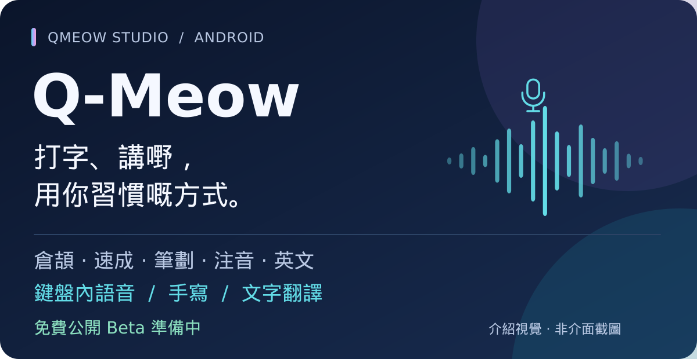
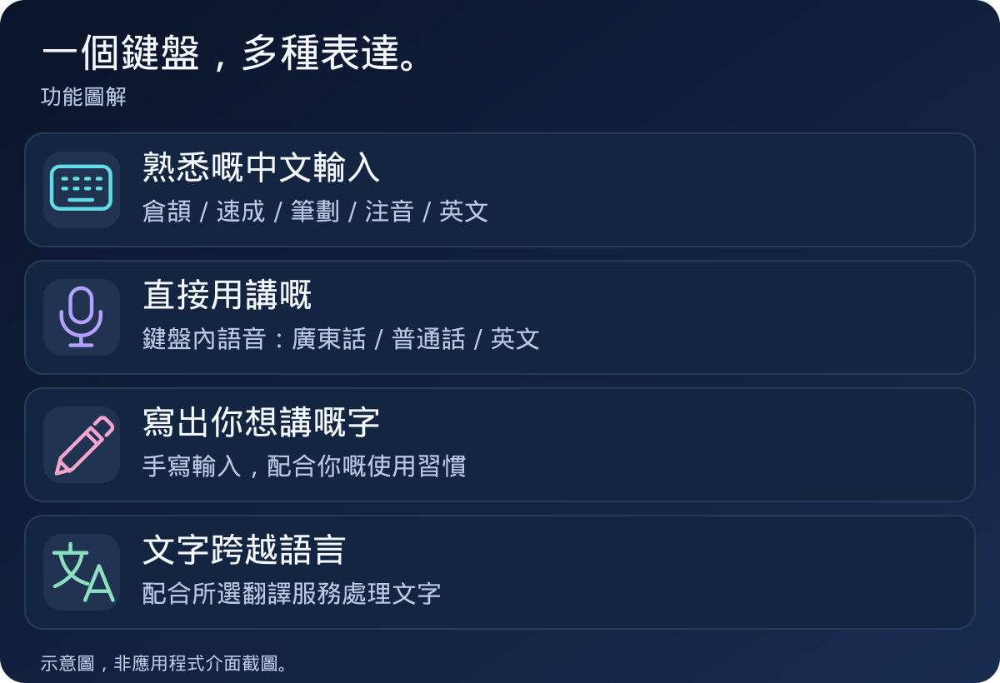
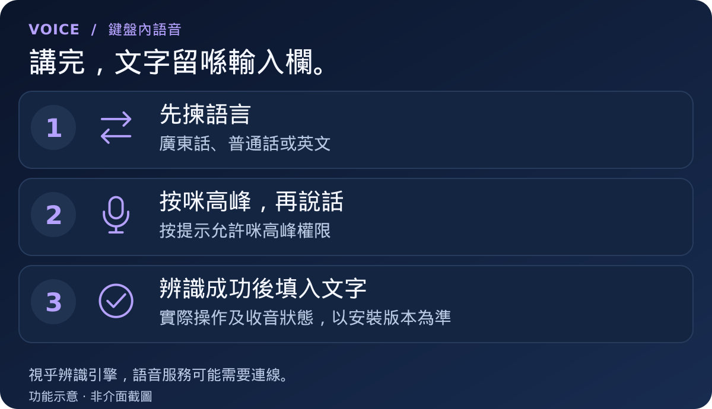
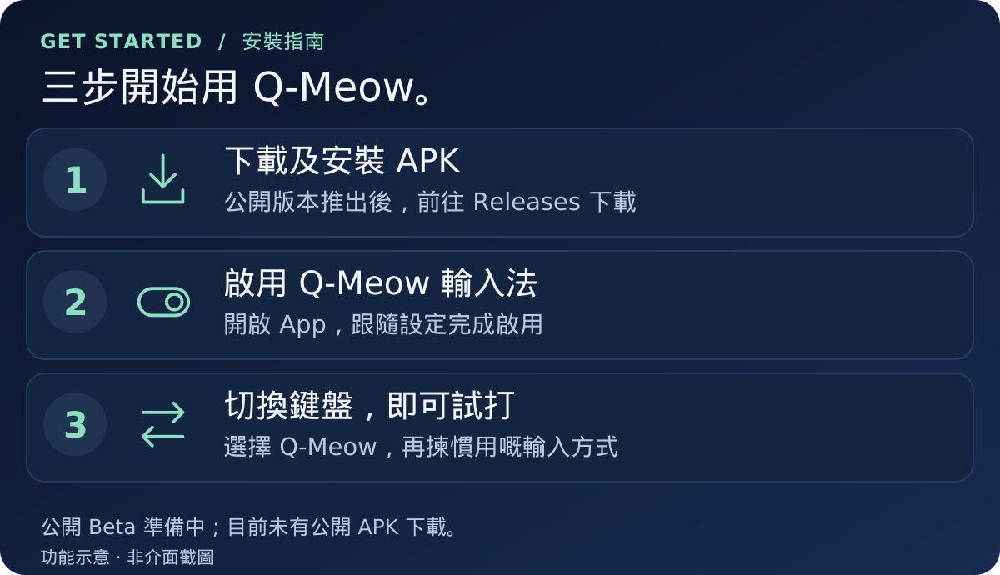

# Q-Meow

**Android 中文輸入法 · 由香港獨立開發者製作**

> **公開 Beta 準備中，目前未提供公開 APK。** 發佈消息、版本說明及安裝檔將集中喺 [Releases](https://github.com/qmeow-studio/Q-Meow/releases)。

Q-Meow 將中文打字、鍵盤內語音、手寫及翻譯放喺同一個輸入法，方便你按習慣選擇輸入方式。計劃以**免費公開 Beta** 形式推出，歡迎一齊測試同改善。

[功能介紹](#主要功能) · [鍵盤內語音](#鍵盤內語音) · [安裝及更新](#安裝及更新) · [私隱與權限](#私隱與權限) · [問題回報](#回報問題及提出建議)

## 主要功能

| 輸入方式 | 支援內容 |
| --- | --- |
| **中文及英文** | 倉頡、速成、筆劃、注音及英文 |
| **鍵盤內語音** | 廣東話、普通話及英文 |
| **手寫** | 用手寫方式輸入文字 |
| **文字翻譯** | 配合所選翻譯服務處理文字 |

本頁插圖用作介紹功能及操作概念，**唔係實際介面截圖，配色亦唔代表現行鍵盤主題**。實際外觀及操作以安裝版本為準。

## 鍵盤內語音

**直接喺鍵盤內操作語音輸入。** 已在開發者測試裝置成功輸入文字；其他手機、系統版本及辨識引擎仍需測試。

語音辨識及翻譯嘅可用性，會受裝置、所選服務、語言及網絡環境影響。鍵盤內操作唔等於完全離線，詳細說明見下方[私隱與權限](#私隱與權限)。

## 安裝及更新

<strong>首次安裝：展開詳細步驟</strong>

以下步驟供公開 APK 推出後使用：

1. 前往 [Releases](https://github.com/qmeow-studio/Q-Meow/releases)，閱讀版本說明及已知問題，再下載附帶嘅 `.apk` 安裝檔。
2. 按 Android 提示，為你用嚟開啟 APK 嘅瀏覽器或檔案管理員允許安裝權限。
3. 安裝後開啟 Q-Meow，跟隨設定啟用輸入法，再切換至 Q-Meow。
4. 需要語音功能時，按提示允許咪高峰權限。

GitHub 提供嘅「Source code (zip)」及「Source code (tar.gz)」係本倉庫內容，**唔係 Android 安裝檔**。

<strong>更新現有 Q-Meow：保留設定</strong>

請先閱讀版本說明。同一套件及相同簽署嘅較新版本，一般可以直接覆蓋安裝。

若出現「無法安裝」或簽署不符，請先回報錯誤，避免直接移除舊版或清除資料，以免遺失設定。

## 測試進度

| 項目 | 目前狀態 |
| --- | --- |
| **免費公開 Beta** | 準備中，尚未發佈 |
| **鍵盤內語音** | 已在開發者測試裝置成功輸入文字 |
| **其他手機及系統相容性** | 仍需測試 |
| **版本說明及驗證資料** | 隨公開版本提供 |

開發者裝置測試成功，唔代表所有裝置都已通過測試。歡迎提供可以重現嘅問題，協助逐步提升穩定性。

## 私隱與權限

| 功能 | 使用前需要知道 |
| --- | --- |
| **咪高峰** | 語音功能需要咪高峰權限。 |
| **語音服務** | 視乎所選辨識引擎，語音可能交由相關服務處理，亦可能需要連線。 |
| **文字翻譯** | 使用網上翻譯時，待翻譯文字會交由所選服務處理；使用前請留意服務說明。 |
| **問題回報** | 請勿公開密碼、私人輸入內容、錄音、API Key，或者完整設定備份。截圖及診斷紀錄亦請先遮蓋個人資料。 |

## 回報問題及提出建議

有問題，或者想 Q-Meow 多一個實用功能？歡迎喺 [Issues 留言](https://github.com/qmeow-studio/Q-Meow/issues)。

<strong>回報時提供咩資料？</strong>

- 手機或平板型號
- Android 版本及 Q-Meow 版本
- 使用緊邊種輸入方式
- 重現步驟、預期結果及實際情況
- 已移除私人資料嘅截圖或診斷紀錄（如有）

語音問題請補充所選語言、辨識引擎，以及有冇成功收音或出字。

---

**由 [qmeow-studio](https://github.com/qmeow-studio) 開發及維護**

多謝你幫手測試 Q-Meow。

[版本動態](https://github.com/qmeow-studio/Q-Meow/releases) · [問題回報](https://github.com/qmeow-studio/Q-Meow/issues)

關於本倉庫及授權

本倉庫用作 Q-Meow 公開介紹、版本下載及問題回報。免費使用與程式碼授權屬不同事項；本頁唔代表將應用程式或第三方元件授予開源授權。

